# Cutout-only baseline: circle vs. square in the latent

**Question.** With photometry, metadata and GP features removed, can the
`LightCurveCompressor` latent separate two trivially different cutout classes?

**Answer.** Yes. With the simple from-scratch CNN the latent goes from chance to
0.86 held-out linear-probe accuracy at 512 training stamps and to 1.00 at
1024–2048. With the frozen Galaxy Zoo Zoobot backbone the latent is already
0.93–0.98 separable *before any training* and 1.00 after 10 epochs. The
from-scratch CNN is data-hungry and noise-fragile; the pretrained backbone is
neither.

Section 8 goes further: shapes the classifier never saw (triangle, ring,
ellipse, cross) are findable in the frozen-Zoobot latent without labels
(novelty AUROC 0.998) but not in any from-scratch CNN latent (≤ 0.75).

All numbers are on a fixed held-out set of 512 stamps that never enters
training, scored by a logistic-regression probe (70/30 split), 5-NN, and the
silhouette of the class labels in the raw latent. Results are mean ± std over
3 seeds unless stated. Figures are in `docs/figures/shapes/` and the raw
per-run JSON in `docs/figures/shapes/results/`.

## Setup

- **Stamps.** 63×63, three channels (science, template, difference). Circles
  and squares are area-matched on average, with random size (radius 8–16 px),
  position (±8 px) and brightness (0.6–1.4), plus Gaussian pixel noise
  (σ = 0.1 by default). Per-channel standardisation as in real preprocessing.
- **Model.** `LightCurveCompressor(mode="ae", latent_dim=16, d_model=64,
  use_images=True, num_classes=2)` with 1 encoder / 1 decoder layer.
- **Cutout-only.** Every source gets one identical all-zero photometry token.
  The transformer CLS output is therefore a constant (verified: zero spread
  across rows with no image), so `z = bottleneck(const + ImageTower(stamp))`.
- **Training.** Cross-entropy on `cls_head(z)` only, AdamW 1e-3, batch 64.
  No reconstruction term, since the dummy photometry carries nothing to
  reconstruct. Gradients flow through `model.encode()`; note that
  `model.embed()` is wrapped in `torch.no_grad` and silently blocks them.

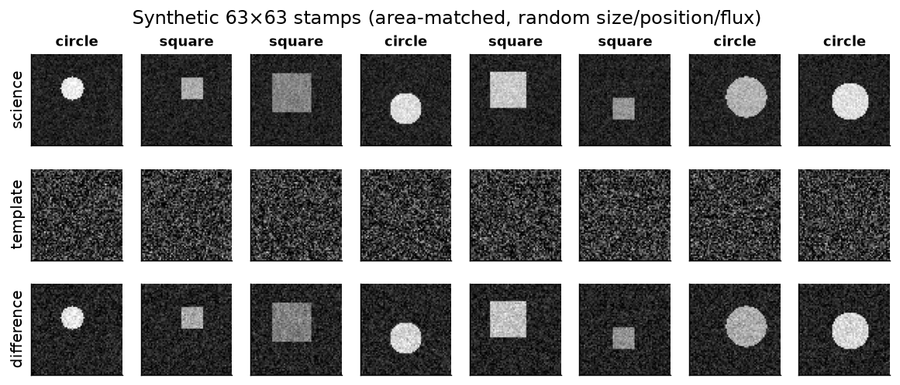

## 1. Training dynamics

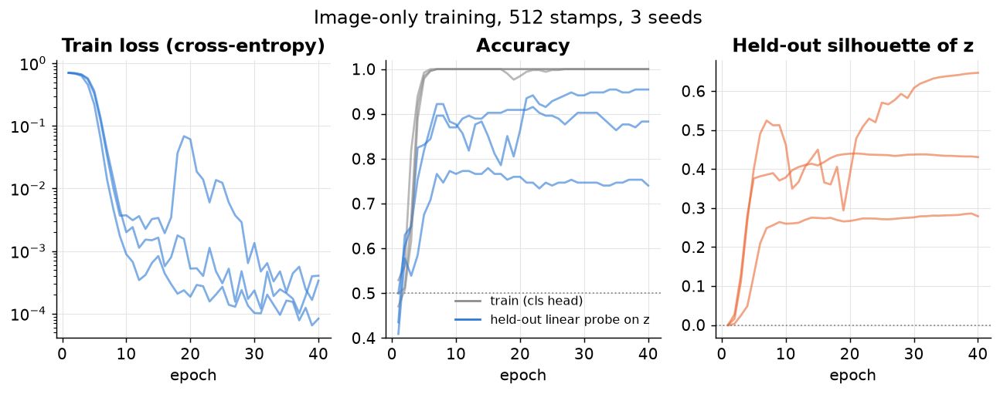

The classification head reaches 100 % on the training stamps by epoch ~6 and
the loss keeps falling to 1e-4, while the held-out probe plateaus around
0.74–0.96 depending on the seed. The gap is generalisation, not optimisation:
a 0.25 M-parameter CNN memorises 512 stamps easily. Silhouette rises with
probe accuracy and stays flat after epoch 20, so 30 epochs is enough.

## 2. Data efficiency

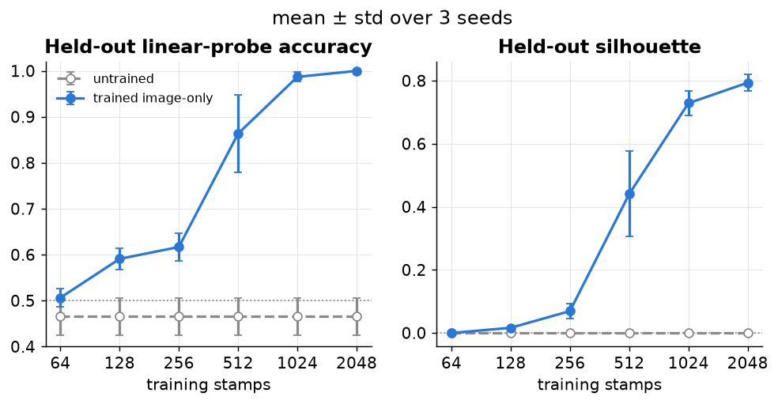

| training stamps | 64 | 128 | 256 | 512 | 1024 | 2048 |
|---|---|---|---|---|---|---|
| probe acc | 0.51 | 0.59 | 0.62 | 0.86 ± 0.08 | 0.99 | 1.00 |
| silhouette | 0.00 | 0.02 | 0.07 | 0.44 | 0.73 | 0.79 |

Below ~256 stamps the from-scratch CNN learns essentially nothing transferable.
The transition happens between 256 and 1024. This is the single most important
knob for the simple backbone.

## 3. Latent dimension

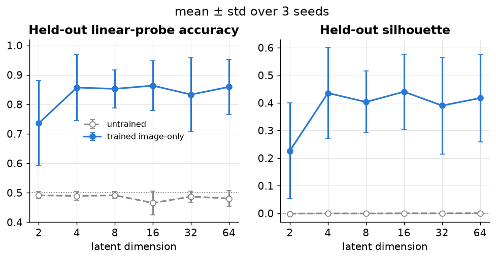

| latent dim | 2 | 4 | 8 | 16 | 32 | 64 |
|---|---|---|---|---|---|---|
| probe acc | 0.74 ± 0.15 | 0.86 | 0.85 | 0.86 | 0.83 | 0.86 |

Anything from 4 dims upward is equivalent; seed variance (±0.08) dominates. A
2-d latent works on 2 of 3 seeds and fails once. Compression is not the
bottleneck for a two-class problem, as expected.

## 4. Noise robustness

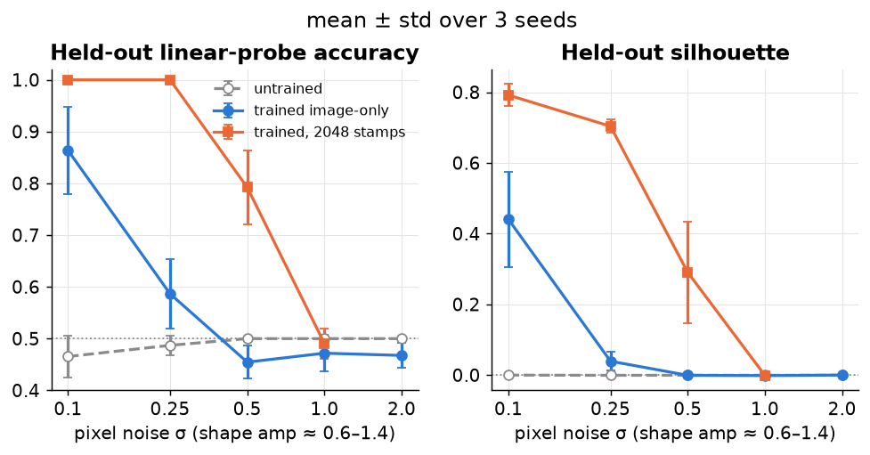

| pixel noise σ | 0.1 | 0.25 | 0.5 | 1.0 | 2.0 |
|---|---|---|---|---|---|
| probe acc, 512 stamps (3 seeds) | 0.86 | 0.59 | 0.45 | 0.47 | 0.47 |
| probe acc, 2048 stamps (2 seeds) | 1.00 | 1.00 | 0.79 | 0.49 | — |
| silhouette, 512 → 2048 | 0.44 → 0.79 | 0.04 → 0.70 | 0.00 → 0.29 | 0.00 → 0.00 | 0.00 |

Blob brightness is 0.6–1.4, so σ = 0.25 is still a per-pixel SNR of 2–6 over
several hundred pixels. At 512 stamps the model nevertheless collapses to
chance by σ = 0.5. With 2048 stamps it is perfect at σ = 0.25 and still useful
at σ = 0.5. So the collapse is a data problem first and a visibility problem
only once per-pixel SNR is ~1. For real stamps with faint hosts this argues
for either much more data or a pretrained backbone (section 6).

## 5. Bottleneck type

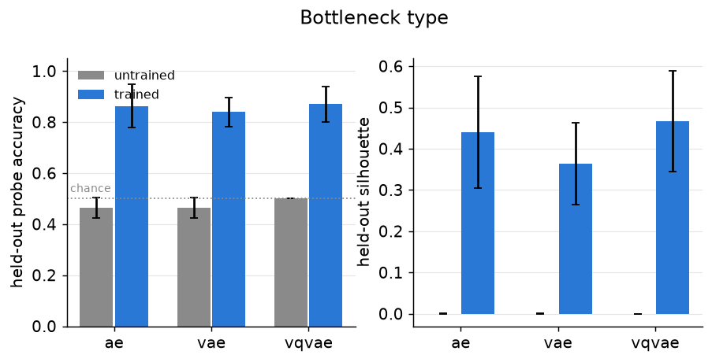

| mode | AE | VAE | VQ-VAE |
|---|---|---|---|
| probe acc | 0.86 | 0.84 | 0.87 |
| silhouette | 0.44 | 0.36 | 0.47 |

All three bottlenecks behave the same here. The VQ-VAE (512 codes, 16-d)
gives the crispest clusters, which is unsurprising for a two-class task.

## 6. Backbone: simple CNN vs. frozen Zoobot

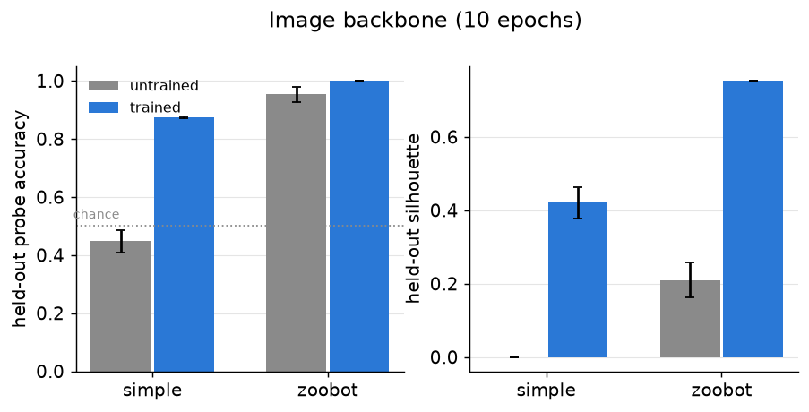

10 epochs, 512 stamps, 2 seeds:

| backbone | probe before training | probe after | silhouette after | wall time / run |
|---|---|---|---|---|
| simple CNN (0.25 M, from scratch) | 0.45 | 0.87 | 0.42 | ~9 s |
| Zoobot ConvNeXt-pico (8.5 M, frozen) | **0.93–0.98** | **1.00** | 0.75 | ~8 min (CPU) |

The Galaxy Zoo features already separate circles from squares linearly through
a *random* projection into the latent. Training only the projection and
bottleneck takes it to perfect. This is the clearest evidence that the
pretrained backbone, not the transformer or the bottleneck, is what makes the
image modality valuable — consistent with the +13 pp early-detection gain in
the README.

## 7. What the trained latent looks like

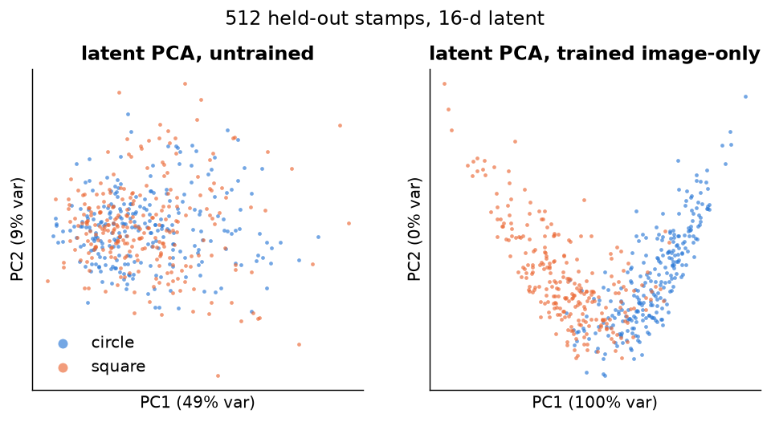
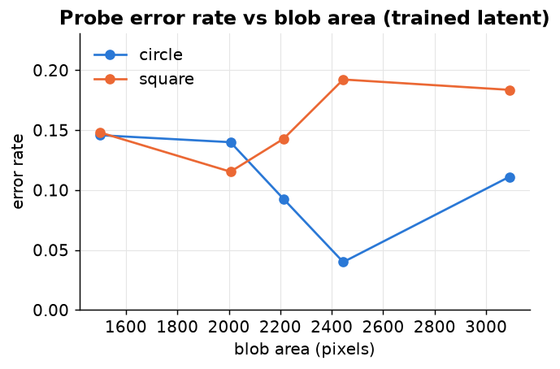

The untrained latent is one blob. After training, PC1 explains 100 % of the
variance: the classification-only loss collapses the 16-d latent onto a single
direction. That is expected here (there is nothing else to encode) and is a
reminder that in the real setup it is the reconstruction loss, not the class
loss, that keeps the remaining latent dimensions alive.

Residual probe errors at 512 stamps (5–20 % per size bin) are spread across
all blob sizes rather than concentrated in the tails, with squares slightly
worse than circles at large areas. The model has not learned a size shortcut;
it is simply under-trained on 512 examples, as section 2 shows.

## Reproduce

```bash
cd src
python sanity_shapes.py --plot shapes.png                 # single run, ~30 s
python shape_experiments.py nstamps --out ../analysis/shapes
python shape_experiments.py plot    --out ../analysis/shapes --fig ../docs/figures/shapes
```

Experiments: `curve`, `nstamps`, `latent`, `noise`, `noise_2048`, `mode`,
`backbone` (needs `pip install timm`; downloads Zoobot weights from
Hugging Face on first use).

## 8. Finding shapes the classifier never saw

**Question.** Train the latent on circles vs. squares only, then push four
shapes it has never seen through the frozen encoder: triangle, ring, ellipse,
cross (all area-matched, random size / position / orientation / brightness).
Can they be *found in the latent without labels*?

This model's decoder reconstructs photometry, not images, so "decoding the
latent" here means reading the latent directly: a label-free novelty score
(mean distance to the 5 nearest circle/square training latents), unsupervised
k-means (does each shape get its own cluster?), and, as an information
ceiling, a 6-way linear probe *with* labels. Effective dimensionality is the
participation ratio of the latent covariance (16 = isotropic, 1 = a line).

Seven ways of producing the latent are compared. All use the real
`LightCurveCompressor` encoder with constant dummy photometry, 2048 training
stamps and 256 held-out stamps per shape; 2 seeds except `zoobot` (1).

| regime | what shapes z | trained on |
|---|---|---|
| `random` | untrained simple CNN | nothing (control) |
| `cls` | simple CNN, cross-entropy on `cls_head(z)` | circle/square labels |
| `recon` | simple CNN + a small stamp decoder, pixel MSE | stamps only |
| `both` | `cls` + `recon` | both |
| `zoobot` | frozen Galaxy Zoo ConvNeXt → random projection | nothing |
| `zoobot_cls` | frozen Zoobot, projection + bottleneck trained with `cls` | circle/square labels |
| `zoobot_both` | frozen Zoobot, trained with `cls` + `recon` | both |

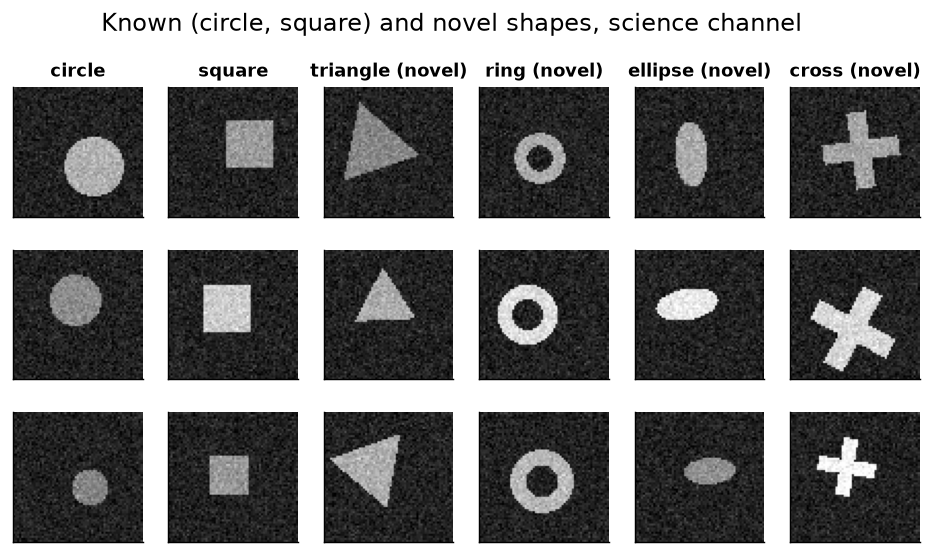

### Results

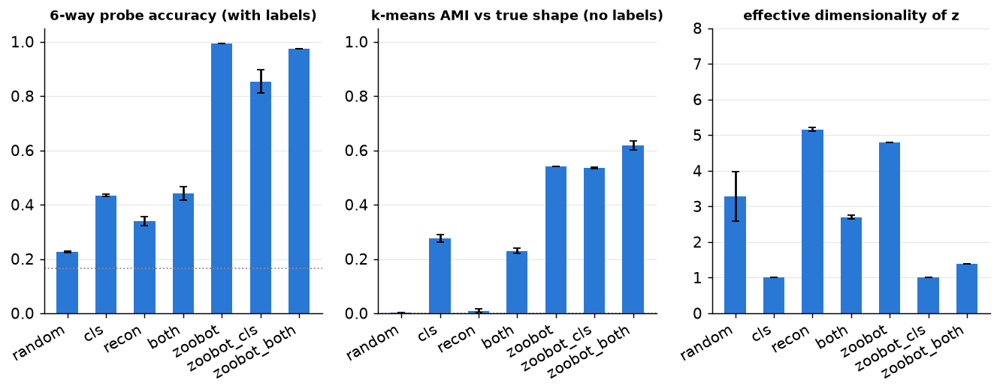

| regime | 6-way probe (labels) | novelty AUROC (no labels) | k-means AMI (no labels) | effective dims |
|---|---|---|---|---|
| random | 0.23 | 0.55 | 0.00 | 3.3 |
| cls | 0.43 | 0.68 | 0.28 | **1.0** |
| recon | 0.34 | 0.75 | 0.01 | 5.2 |
| both | 0.44 | 0.68 | 0.23 | 2.7 |
| zoobot | **0.995** | **0.998** | 0.54 | 4.8 |
| zoobot_cls | 0.85 | 0.96 | 0.54 | **1.0** |
| zoobot_both | 0.97 | 0.97 | **0.62** | 1.4 |

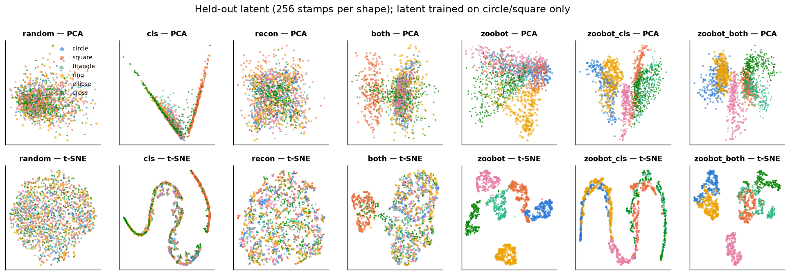

**The from-scratch CNN cannot find them, whatever the loss.** Even with
labels, a 6-way probe on the `cls` latent reaches only 0.43: the latent is a
single line (effective dimensionality 1.0, the "V" in the PCA panel) and the
novel shapes are strung along the circle-to-square axis. A circle/square probe
calls 100 % of triangles, rings and ellipses "circle" with full confidence, so
the softmax-confidence novelty baseline is at chance (AUROC 0.48). Distance in
the latent does slightly better (0.68) only because novel shapes tend to land
between the two class clusters. Adding a pixel-reconstruction loss (`recon`,
`both`) raises the effective dimensionality but not the shape information: pixel
MSE rewards encoding position, size and brightness, which are nuisance
variables here. The `recon` latent has no cluster structure at all (AMI 0.01).

**The frozen Zoobot latent finds all four, with no training whatsoever.** A
random 512→64→16 projection of Galaxy Zoo features gives novelty AUROC 0.998
for every novel shape, and a labelled probe separates all six shapes at 0.995.
Unsupervised k-means (k = 6) gives ring its own pure cluster (95 % recall, 100 %
purity) and cross two clusters of its own; triangle and ellipse share a cluster
with each other, which is what caps the AMI at 0.54. The t-SNE panel shows
five clean islands.

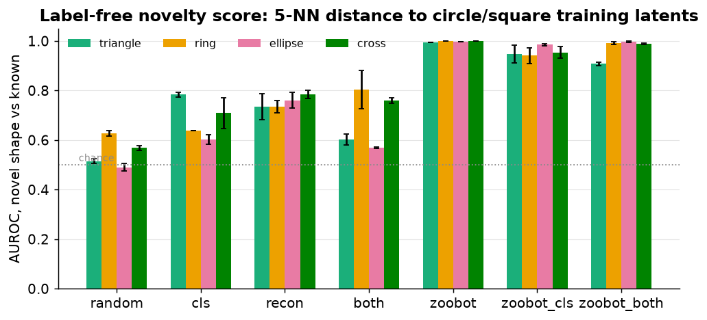
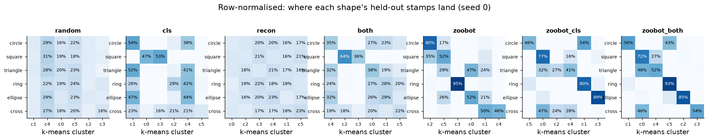

**Training the projection on circle/square collapses the Zoobot latent too, but
novelty survives.** `zoobot_cls` drives the latent to effective dimensionality
1.0 (t-SNE shows a 1-D curve) and the 6-way probe drops from 0.995 to 0.85.
Yet the novel shapes are still detectable at AUROC 0.96, because each one is
mapped to its own stretch of the curve rather than onto the class clusters:
ellipse gets a near-pure cluster (89 % recall, 82 % purity), ring 79 %. The
classifier is confidently wrong on triangle and cross (calls them squares;
confidence AUROC 0.35 and 0.41), so only the latent-distance score catches
them. Adding the reconstruction term (`zoobot_both`) keeps the probe at 0.97
and gives the best clustering (AMI 0.62): triangle and ellipse are now separate
clusters, cross still splits in two.

### What this says about the pipeline

- Discoverability of unseen classes comes from the pretrained backbone, not
  from the transformer, the bottleneck, or the classification head. A CNN
  trained from scratch on two classes learns a two-class detector and nothing
  else.
- The joint classification loss is aggressive: it flattens the latent to one
  effective dimension in every regime that uses it, including on top of Zoobot.
  In this toy it costs 15 points of probe accuracy on unseen classes; whether it
  costs discoverability on real alerts is exactly what `eval_discovery.py` is
  meant to measure.
- A weak reconstruction term restores most of the lost information here.
  In the real model the photometry reconstruction plays that role, but it acts
  on the light curve, not the stamp, so it does not protect image information.
- Classifier confidence is not a usable novelty signal. Distance in the latent
  is, provided the latent was not trained to collapse.

Reproduce (each trained regime ~3 min; Zoobot regimes ~6–8 min on CPU):

```bash
cd src
for r in random cls recon both zoobot zoobot_cls zoobot_both; do
  python shape_novelty.py run --regime $r --seed 0 --out ../analysis/shapes/novelty
done
python shape_novelty.py plot --out ../analysis/shapes/novelty --fig ../docs/figures/shapes
```
